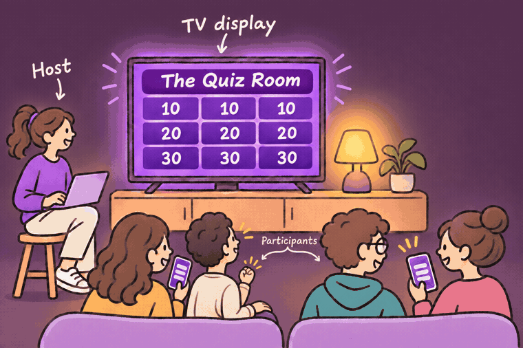

# The Quiz Room

Bring a quiz night to your next party. The Quiz Room turns your computer into a host desk, your TV into a question board, and one phone per team into a buzzer. Friends join by scanning a QR code; the host chooses questions, reveals answers, and awards points.



Decks, media, scores, and results stay on the host computer. Players need no account or app, and local hosting needs no cloud service.

## What you can do

- Build decks with boards, categories, point tiles, and optional images, audio, or video.
- Choose a theme and optionally add your own logo, background, or buzzer sound.
- Show the board, questions, answers, and scoreboard on a TV while teams buzz from their phones.

A fresh install starts with a short practice deck and no sessions or uploaded assets. Existing hosts keep their own content in the Git-ignored `.quiz-data/` folder.

## Requirements

- **Host:** A laptop with [Node.js 22 or newer](https://nodejs.org/). Run the app there and optionally connect a TV or projector for the board. `npm ci` installs the dependencies from `package-lock.json`.
- **Teams:** One phone per team, on the same Wi-Fi network as the host laptop. Players scan the session QR code to use their browsers as buzzers; they need no account or app.
- **Questions:** Use the included practice deck, build one in the app, or upload a CSV in the [example format](examples/quiz-template.csv) with any referenced media files.
- **Host access:** The host signs in with a private code generated on first run or chosen during setup. Participants use the QR invitation, not the host code.

## Host your first quiz

```sh
npm ci
npm start
```

1. Open `http://localhost:3000` on the host computer. The first run prints a randomly generated **host access code** in the terminal. Save it privately and use it to sign in. No code is included in this repository.
2. Choose one of the five themes in **Themes**: Midnight Quiz, Classic Light, Diwali Lights, Christmas Cheer, or India Tricolor. You can optionally upload a logo or background image. Save the theme.
3. Create a question deck in the app, or select **Import CSV folder** and choose a folder containing `questions.csv` and its `media/` files.
4. Select **Host quiz** and enter a session name. Open the TV display in another window and move it to your TV.
5. Ask one captain per team to scan the QR code and enter a team name. Run the buzzer check, then start the board. Select questions, resolve buzzes, reveal answers, and award points from the host desk.
6. Select **End quiz** when finished. The QR invitation and team access expire; the results stay in **Sessions**.

If you reopen the app or sign in from another tab, it resumes the session already in progress. **Sessions** shows its name, status, and number of joined teams. You can return to the same host desk; you do not need to ask teams to join a new room. Starting again while a session is active reuses that room. Guest access also expires after 12 hours if a session is left open; history is retained.

## Host and player screens

| Screen     | Who opens it                               | What it does                                                                                                                                 |
| ---------- | ------------------------------------------ | -------------------------------------------------------------------------------------------------------------------------------------------- |
| Host desk  | The host, after signing in on the computer | Edits decks and themes, starts or resumes a named session, chooses questions, controls the TV, resolves buzzes, and manages scores.          |
| TV display | The host, using **Open TV display**        | Shows the invitation QR, board, current question, revealed answer, and scoreboard. This link is private; the host opens it on the TV.        |
| Team phone | One captain per team, using the QR         | Joins with a team name, checks the buzzer, buzzes when it opens, and sees the team's score. Players do not need the host code or an account. |

If a captain reloads the same phone, their team session resumes. A new phone needs **Replace phone** at the host desk. Keep the TV and host tabs on the same running server and named session.

The QR uses the computer's network address. If it points to the wrong interface, start with your actual LAN address:

```sh
QUIZ_PUBLIC_ORIGIN=http://192.168.1.25:3000 npm start
```

Replace the example address. A phone's `localhost` means the phone itself. Keep the computer awake and the server running during the party. No public tunnel or router port forwarding is needed.

## Make a question set

You can edit a deck in the app: add boards, rename categories, choose a point tile, write a question and answer, and optionally add a hint, host note, image, audio clip, or video. Question and answer audio/video appear with playback controls. An optional MP3/WAV can replace the generated buzzer chime.

For a larger set, use [the example CSV](examples/quiz-template.csv). Keep its header unchanged and put any referenced files in a `media/` folder beside it:

```text
my-quiz/
  questions.csv
  media/
    photo.png
    music.mp3
    buzzer.wav
```

With the app running, select **Import CSV folder** in **Quiz decks** and choose the whole `my-quiz` folder. The app checks the CSV and uploads its media, then shows the new deck. To import from a terminal instead, stop the server and run:

```sh
npm run csv:import -- my-quiz/questions.csv
npm start
```

Import adds a deck without replacing existing ones. A media cell contains a **relative path**, such as `media/photo.png`. The image or audio bytes live in that file, not inside the CSV. Keep the CSV and `media/` folder together when sharing a question set. Files may be up to 10 MB each. Supported types are PNG, JPG, WebP, MP3, WAV, MP4, and WebM.

| Column                                  | Meaning                                                                                                    |
| --------------------------------------- | ---------------------------------------------------------------------------------------------------------- |
| `Deck Title`                            | One deck title, repeated on every row.                                                                     |
| `Board Number`, `Board Name`            | Board order from `1`, and its title; up to 10 boards.                                                      |
| `Category Number`, `Category Name`      | Left-to-right order from `1`, and its heading; up to 8 categories per board.                               |
| `Question Number`                       | Top-to-bottom position from `1`; up to 6 questions per category.                                           |
| `Points`                                | Number from 0 to 10,000. Each horizontal row uses the same points across its categories.                   |
| `Question`, `Answer`                    | Required text. Use CSV quotes for commas or line breaks. The answer stays private until revealed.          |
| `Hint`, `Host Notes`                    | Optional; host notes are private.                                                                          |
| `Question Media`, `Answer Media`        | Optional paths to an image, audio clip, or video.                                                          |
| `Buzzer Sound`                          | Optional path to one MP3/WAV file, repeated on every row.                                                  |
| `Logo`, `Background`                    | Optional paths to images, repeated on every row. These override the selected theme's images for this deck. |
| `Category Icon`, `Category Description` | Optional host category cues, repeated within that category.                                                |

All 18 columns must be present, even when optional cells are blank. Board, category, and question numbers start at 1 and have no gaps. A spreadsheet can export this format as CSV. The app checks the file and media before adding the deck.

To export one of your saved decks with all its referenced assets:

```sh
npm run csv:export -- path/to/output-folder "Exact deck title"
```

This creates `questions.csv` and `media/`. Review any questions and images before sharing them. Your own themed question sets can be distributed separately from the app.

## Local data and access

The app saves decks, themes, media, scores, and history under `.quiz-data/`, which Git ignores. Keep it private: it contains answers and active session credentials. **Settings → Export complete backup** includes decks, themes, and referenced media. To back up game history too, stop the server and copy the entire `.quiz-data/` folder.

The host code is randomly generated and stored only as a salted hash. To choose a private code on first setup, use at least 12 characters:

```sh
QUIZ_HOST_PASSWORD='your-own-long-private-code' npm run setup
npm start
```

To reset a forgotten code, stop the server, then run `npm run setup -- --reset` followed by `npm start`. A co-host can use the same code. Teams only use the QR invitation. Never commit or post a real host code.

The local app uses HTTP on a trusted home network. Keep it off the public internet. It runs one server process per data folder. See [architecture and security details](docs/architecture.md). Environment settings are in [.env.example](.env.example); the app reads shell variables and does not load `.env` files automatically.

Before inviting friends, follow the [end-to-end test checklist](docs/release-check.md). It covers the host, TV, phone, media, buzzer timing, and session resume.

## Develop

```sh
npm test
npm run format:check
```

`npm start` builds and runs the local app. The code is available under the [MIT License](LICENSE). Your own questions and media remain yours to share separately.
